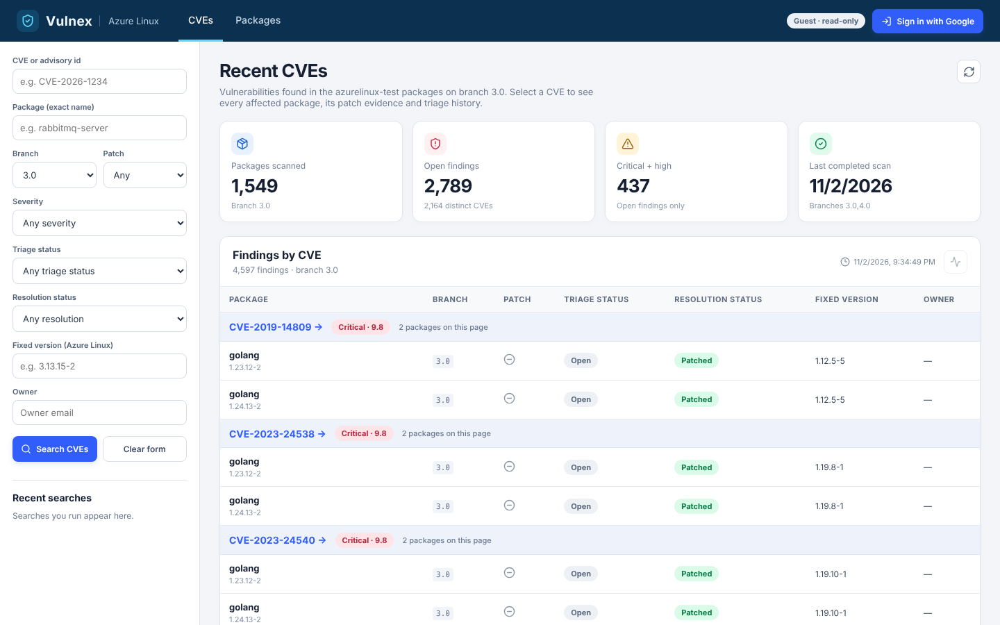

# Vulnex

A dashboard that shows which security holes (CVEs) still affect the packages in Azure Linux, and lets engineers triage them.



## What it does

- Scans the package recipes in [`azurelinux-test`](https://github.com/akhila-dev5/azurelinux-test) every day.
- Checks each CVE against what the recipe already patches, so only real exposures show up.
- Shows every affected package for a CVE, with the Azure Linux fixed version where one exists.
- Lets an admin comment, dispute, link a pull request and record a patch verdict.

## Try it

```bash
make install
make serve        # http://localhost:8000
```

Needs Python 3.11+. To work on the screens, also build the frontend: `cd frontend && npm ci && npm run build`.

## Learn how it works

The notes in [`docs/`](docs/README.md) explain the project one topic at a time:

[Overview](docs/01-overview.md) · [Architecture](docs/02-architecture.md) · [Frontend](docs/03-frontend.md) · [Backend](docs/04-backend.md) · [Database](docs/05-database.md) · [Scanning](docs/06-scanning.md) · [Deployment](docs/07-deployment.md) · [Technologies](docs/08-technologies.md) · [Running locally](docs/09-running-locally.md)

## Built with

Python, FastAPI, PostgreSQL / SQLite, React, TypeScript, Vite, GitHub Actions, Netlify, Render, Supabase.

## License

See [LICENSE](LICENSE).
