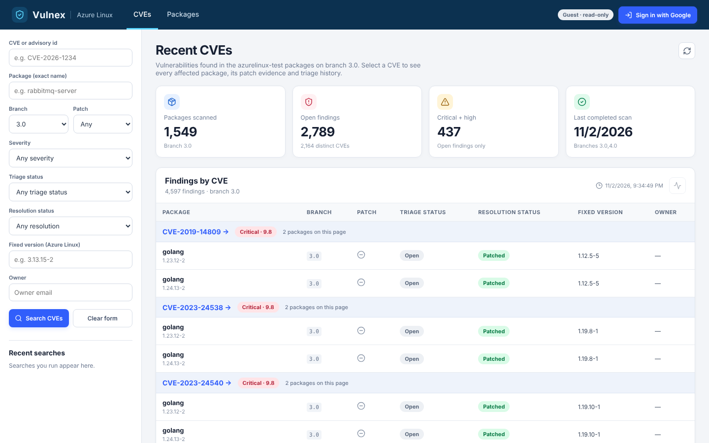

# 1. Overview

## What Vulnex is

Vulnex is a dashboard that shows which known security holes (CVEs) still affect the packages in **Azure Linux**. It reads the package recipes from the `akhila-dev5/azurelinux-test` repository (stable branch **3.0** by default), compares each package against public vulnerability data, and checks whether Azure Linux has already fixed the problem.

It also gives engineers a place to **triage**: leave comments, dispute a finding, attach a pull request link, and record a patch verdict.

## The problem it solves

A simple scanner says "package X is older than the upstream fix, so it is vulnerable". That is often wrong, because Azure Linux **backports** fixes: it adds a patch to the old version instead of upgrading. Vulnex therefore checks three things before calling something exposed:

1. Is the package version inside the vulnerable range?
2. Does the package recipe already apply a patch for this CVE?
3. Does the recipe say explicitly that the CVE does not apply (a `.nopatch` marker)?

## Who uses it

| Role | How they sign in | What they can do |
|------|------------------|------------------|
| Guest (viewer) | Nobody, just open the site | Read everything |
| Admin | Google sign-in, only the allow-listed email | Comment, dispute, triage, set patch verdict, set PR link, run a scan |
| Automation | A static key sent in a header | Only set the pull request link |

## Words you will see

| Word | Plain meaning |
|------|---------------|
| **CVE** | A public ID for one security flaw, such as `CVE-2026-78663` |
| **Package / spec** | One software package. Its recipe is a `.spec` file |
| **EVR** | Epoch:Version-Release, the full version of an RPM package, such as `1.1.0-2` |
| **rpmvercmp** | The rule RPM uses to decide which version is newer. Vulnex has its own port of it |
| **Advisory** | A published note that a CVE affects some package versions. Vulnex uses OSV.dev |
| **Affected** | The package is in the vulnerable range and nothing in the recipe fixes it |
| **Patched** | The recipe applies a patch or its changelog names the CVE |
| **False positive** | The recipe carries a `CVE-*.nopatch` marker: Azure Linux says it does not apply |
| **Unconfirmed** | The advisory is too vague to decide, so a human should look |
| **Patch available** | An **upstream** patch exists for the CVE. It says nothing about the spec file |
| **Fixed version** | The azurelinux-test version-release in which the CVE was patched. Blank while unpatched |
| **Upstream fixed version** | The version the original project fixed it in. Shown only in the Deep view |
| **Deep** | A pop-up with the source files the CVE touches and the backport patches |
| **Snapshot** | The scan result saved as `data/vulnex.db` and refreshed daily |

## Two ideas that are easy to mix up

- **Patch available** is about the **upstream** project: a fix exists somewhere.
- **Fixed** is about **azurelinux-test**: the package recipe already contains the fix, and the "Fixed version" column shows the release that shipped it.

Fixed CVEs are also written to a list (`data/fixed-cves.json`) in the `VulnerabilityData` repository.
