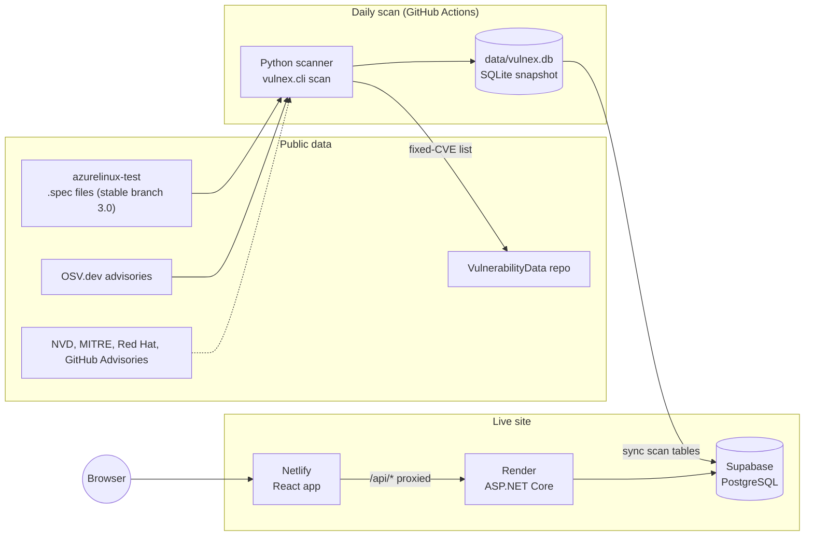

# 2. Architecture

## The parts

| Part | Where it runs | Job |
|------|---------------|-----|
| React app | Netlify | The screens people see |
| ASP.NET Core service | Render (free) | Reads and writes data, signs people in, runs scans on demand |
| PostgreSQL | Supabase (free) | Keeps scan results **and** what people type (comments, disputes, PR links) |
| SQLite snapshot | Committed in the repo (`data/vulnex.db`) | The scanner's output; also the fallback when no database URL is set |
| Scanner | GitHub Actions, daily | Collects specs, matches advisories, verifies, saves the snapshot |

## Why two databases?

The scanner produces a SQLite file because it is simple and needs no server. The live site needs data that survives restarts, so it uses PostgreSQL. After each scan, only the **scan tables** are copied into PostgreSQL. The tables people write to (comments, disputes, PR links) are never overwritten.

## What happens when you open the CVE list

1. The browser loads the React app from Netlify.
2. The app asks `/api/stats` and `/api/findings?...`. Netlify forwards `/api/*` to Render, so the browser sees one site and CORS never matters.
3. The .NET API checks an in-memory cache (60 seconds). On a miss it queries PostgreSQL with the filters applied in SQL, adds the triage and patch information for just the visible page, and returns compressed JSON.
4. The app groups rows by CVE and draws the table.

Clicking a CVE opens `#/cve/<id>`. That page calls `/api/cves/<id>` and shows every affected package with its Deep and Actions buttons.

## What happens on a scan

1. GitHub Actions starts the scan once a day, or when someone starts it by hand.
2. The scanner reads every `.spec` file from the branch, asks OSV which advisories apply, and verifies each match against the recipe (see [Scanning](06-scanning.md)).
3. The result replaces the SQLite snapshot, which is committed back to the repo.
4. If the `DATABASE_URL` secret exists, the scan tables are copied to PostgreSQL.
5. The list of fixed CVEs is published to the `VulnerabilityData` repository.

## Design choices worth knowing

- **Hash routing** (`#/cve/...`). The site is plain static files, so no server rewrite rules are needed and every CVE has a shareable link.
- **One request per list, not one per row.** Triage records are read in one query. Per-row queries over a network database were the cause of an earlier "Request failed" bug.
- **The app survives a missing database.** If PostgreSQL is unreachable, the API reports it clearly instead of crashing at startup.
- **Sessions live in memory.** There is no user table. Restarting the server signs everyone out, which is acceptable for a single-admin tool.
