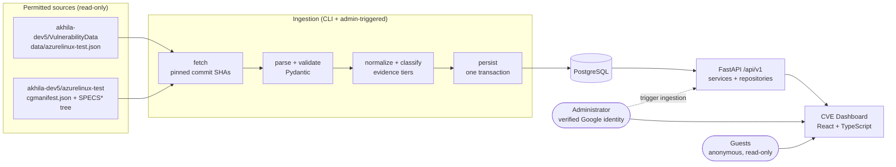

# Step 2: Implementation plan

**Status:** proposal for owner review. Documentation only; nothing here is implemented yet.
Every claim about the sources is evidenced in [`01-source-inspection.md`](01-source-inspection.md).
Items marked **D1, D2, …** are decisions for the owner; each has a recommendation.

## 1. Guiding ideas

1. **A CVE appearing near a package is not evidence.** Every package-CVE association is stored
   with *how it was found* and *what supports it*, and the UI shows that.
2. **Unique CVEs and occurrences are different things.** The feed has 7,042 distinct CVEs but
   7,177 package-CVE rows. The API and UI always say which one a number counts.
3. **Ingestion is the only writer of vulnerability data and it only reads two repositories.**
4. **Failure must never damage good data.** A failed run changes nothing except its own
   status row.
5. **Beginner-maintainable:** a modular monolith, boring tools, one responsibility per module.

## 2. Architecture



The browser only ever talks to FastAPI. FastAPI is the only component that reads the
database for users; the ingestion component is the only one that writes vulnerability data.

### Backend layout (adapted from the brief)

```
backend/
  app/
    main.py            # creates the FastAPI app
    config.py          # settings from environment variables (Pydantic Settings)
    api/v1/            # routers: thin, validate input, call services
    schemas/           # Pydantic request/response models
    models/            # SQLAlchemy 2.x tables
    repositories/      # database queries only
    services/          # business logic (summaries, search, aggregation)
    ingestion/         # fetch.py, parse.py, normalize.py, match.py, persist.py, runner.py, cli.py
    auth/              # OIDC login, sessions, CSRF, role checks
    db/                # engine/session setup
  migrations/          # Alembic
  tests/
frontend/              # React + TypeScript + Vite
```

Rule of thumb for a beginner: **routers talk to services, services talk to repositories,
repositories talk to the database.** Nothing skips a layer.

## 3. Why these technologies

| Tool | Why it earns its place here |
| --- | --- |
| FastAPI | Typed routes, automatic validation, free OpenAPI docs at `/docs`: easy to learn and inspect. |
| Pydantic | The same models validate untrusted source files at ingestion *and* shape API responses. |
| PostgreSQL | Real constraints, transactions, advisory locks (used to prevent concurrent ingestion), JSONB for source `ranges`. |
| SQLAlchemy 2.x | Parameterized queries by construction (no string-built SQL); typed models. |
| Alembic | Schema changes are reviewed, versioned and reversible. The app never creates tables on startup. |
| React + TS + Vite | See D3. |

No Redis, Celery, Kafka or Kubernetes: nothing here needs them.

## 4. Ingestion design

### 4.1 Pipeline

```
resolve refs -> fetch -> parse -> validate -> normalize/classify -> persist -> record result
```

1. **Resolve refs to commit SHAs.** Configured refs (e.g. `VulnerabilityData@main`,
   `azurelinux-test@main`) are resolved once, up front, to full commit SHAs through the GitHub
   API for those two repositories. All later fetches use the SHA, so a run cannot see a mixture
   of two revisions.
2. **Fetch.** `httpx` with explicit timeouts, a maximum body size, bounded retries with
   backoff (idempotent GETs only), HTTPS only, and a strict allow-list: only
   `raw.githubusercontent.com`/`api.github.com` paths under the two permitted repositories.
   Redirects to other hosts are refused.
3. **Parse.** Pydantic models mirror the schema in the inspection doc. `schema_version != 1`
   stops the run with a clear error; it is never guessed at.
4. **Validate.** Row-level problems (malformed CVE id, unknown `match` value, missing
   fields, out-of-range CVSS) go to a reject list with a reason and the source path; the run
   continues and reports `rejected_count`. Structural problems (not valid JSON, no
   `packages`, schema mismatch) fail the run.
5. **Normalize.** One `vulnerabilities` row per CVE (merge rule: take non-null description;
   severity/CVSS/dates are consistent across rows in the current data and a conflict is
   rejected as a data error). One association per (package, CVE).
6. **Classify.** Assign the evidence tier (section 5).
7. **Persist.** One database transaction: upsert by natural keys, stamp `last_seen_run_id`.
8. **Record.** The run row stores status, both source commit SHAs, `generated_at` from the
   feed, start/end times, counts, rejects and a sanitized error. The run row is written in its
   own transaction at start and end, so a failure is still recorded after the data
   transaction rolls back.

### 4.2 Safety guarantees (each gets a test)

| Requirement | Mechanism |
| --- | --- |
| Retry-safe, no duplicates | Unique constraints on natural keys + upserts |
| Failed run leaves data untouched | Data writes in one transaction; rollback on any exception |
| No concurrent runs | `pg_try_advisory_lock` plus a unique partial index allowing a single `running` row; a second attempt gets HTTP 409 / CLI exit code |
| Nothing silently deleted | No hard deletes. Rows missing from a later *successful, complete* run are flagged `not in latest run`, not removed |
| Not run at server start | Ingestion is a CLI command or an admin-only POST; app startup never triggers it |
| Repo content is data | Parsed with `json`/Pydantic only. `scan.py`, specs and workflows are never executed or `eval`'d |
| Traceability | Every row links to the run that last saw it; every run records both commit SHAs |

### 4.3 The manifest-revision problem (see inspection §4.3)

The feed does not say which `azurelinux-test` commit it used, and it was generated from
`main`, not the default branch `3.0`. Vulnex will:

1. Fetch `cgmanifest.json` at the configured ref (default: `main`, see D1).
2. **Verify** every feed package/version against that manifest. Today all 473 match `main`
   exactly; against `3.0`, 294 of 453 would not.
3. If verification fails for a package, store its rows as `unverified` with the reason
   `manifest-mismatch` and show a visible banner, instead of failing silently or pretending.

### 4.4 Spec evidence (second slice)

From one recursive tree listing of `azurelinux-test` at the pinned SHA (no per-file
downloads), find files under `SPECS*/<package>/` whose names contain the CVE id:
`*.patch` → "distro patch present"; `*.nopatch` → "marked not applicable". On `main` that
corroborates 367 of 7,177 rows without a single extra request. Parsing `Patch:` directives
for the 462 relevant spec files is a later refinement.

## 5. How a CVE is related to a package (and how sure we are)

Each association stores `match_type`, `version_evidence`, the source `ranges`, and any spec
evidence. From these the API computes one `verification_status`:

| `verification_status` | Rule | Rows today | What the UI says |
| --- | --- | --- | --- |
| `version_supported` | feed `match=cpe`, bounded range or pinned version, manifest verified | 1,906 (1,791 bounded + 115 pinned) | "NVD CPE data supports this version" |
| `version_unbounded` | `match=cpe`, only empty ranges (NVD "all versions") | 294 | "NVD lists no version bound; not version-verified" |
| `unverified` | `match=keyword`, or manifest mismatch | 4,977 (+ any mismatches) | "Mentioned in the CVE text only; no version evidence" |
| overlay: `distro_patch_present` | CVE id in a patch file name in the spec directory | 367 | "A patch for this CVE exists in the spec" + path |
| overlay: `marked_not_applicable` | `*.nopatch` marker | 30 | "Distro marks this as not applicable" + path |

The first three rows partition all 7,177 rows (1,906 + 294 + 4,977). Counts are measured on
the current feed against `main`'s manifest; the same split is recomputed at ingestion time
and checked by tests, and **the dashboard never shows the feed's own `stats`**.

No status is called "confirmed exploitable". The strongest claim the sources support is
"version-supported by NVD CPE data, and no distro patch evidence found". The dashboard states
that limitation on the overview and detail pages.

## 6. Database schema

Every table below exists for a reason stated in its row. Timestamps are `timestamptz`; feed
timestamps have no zone and are **assumed UTC** (inspection §3, item 8).

| Table | Purpose | Key columns / constraints |
| --- | --- | --- |
| `ingestion_runs` | Audit and traceability of every run | `id`, `status` (`running`/`succeeded`/`failed`), `started_at`, `finished_at`, `triggered_by`, `vulndata_commit_sha`, `vulndata_generated_at`, `vulndata_schema_version`, `manifest_ref`, `manifest_commit_sha`, counts, `rejected_count`, sanitized `error` |
| `ingestion_rejects` | Why individual source rows were refused | `run_id` FK, `source_path`, `reason`, truncated `raw` |
| `packages` | A component+version from the manifest | `name`, `version`, `distribution_ref`, `tarball_url`, `last_seen_run_id`; **unique (`name`, `version`, `distribution_ref`)** |
| `vulnerabilities` | One row per distinct CVE | **unique `cve_id`**, `description`, `severity`, `cvss_score`, `cvss_vector`, `published_at`, `modified_at`, `last_seen_run_id` |
| `package_vulnerabilities` | The association, with evidence | FKs to both; **unique (`package_id`, `vulnerability_id`)**; `match_type`, `version_evidence`, `ranges` JSONB, `affected_versions` JSONB, `first_seen_run_id`, `last_seen_run_id`, `in_latest_run` |
| `spec_evidence` | Patch/nopatch files found in `azurelinux-test` | FK to the association, `kind`, `repo_path`, `commit_sha` |
| `users` | The administrator (and only persisted identities) | `email`, `oidc_subject` (pinned), `role`, `last_login_at` |
| `sessions` | Server-side sessions, revocable | hashed token, `user_id`, `expires_at` |
| `audit_events` | Who did what | `actor`, `action`, `target`, `request_id`, `at` |

All manifest packages (3,091 on `main`) are stored, not only the 473 with findings, so the
overview can state an honest denominator ("473 of 3,091 packages have findings in the feed").
Absence of a finding is **not** shown as "safe".

Indexes: `vulnerabilities(severity)`, `package_vulnerabilities(package_id)`,
`package_vulnerabilities(vulnerability_id)`, `packages(name)` (plus trigram on name/CVE for
search if profiling shows it is needed).

## 7. REST API (`/api/v1`)

| Endpoint | Auth | Notes |
| --- | --- | --- |
| `GET /health` | none | Liveness; `GET /health/ready` also checks the database |
| `GET /summary` | none | Distinct CVEs, occurrences, per-status and per-severity counts, last successful run, staleness flag |
| `GET /cves` | none | **Distinct CVEs** with `package_count`; search, severity filter, sort, pagination |
| `GET /cves/{cve_id}` | none | CVE + every affected package with evidence and links into the two repos |
| `GET /findings` | none | **Occurrences** (package-CVE rows) with `verification_status`; filters/sort/pagination |
| `GET /packages`, `GET /packages/{name}` | none | Packages, their versions and associated CVEs |
| `GET /ingestion-runs`, `GET /ingestion-runs/{id}` | none | Public, sanitized (no stack traces) |
| `POST /admin/ingestion-runs` | **admin** | Returns `202` + run id; `409` if one is running |
| `GET /auth/login`, `/auth/callback`, `POST /auth/logout`, `GET /auth/me` | n/a | OIDC login |

`/findings` is an addition to the brief's example list: it is what makes the
unique-CVE vs occurrence distinction explicit. Responses use explicit Pydantic models, a
single error shape `{ "error": { "code", "message", "request_id" } }`, and never include
internal exception text. Every request gets a correlation id (`X-Request-ID`), logged with
structured logs that never contain secrets.

## 8. Authentication and authorization

- **Roles.** `admin` and `guest`. Anonymous visitors have exactly guest capabilities, so
  nobody needs an account to browse.
- **Login: Google OIDC** (authorization-code flow with PKCE). The backend validates the ID
  token itself (signature against Google's keys, `iss`, `aud`, `exp`, `nonce`). Admin requires
  **`email_verified = true` and the email equal to `ADMIN_EMAIL`** (the owner's address,
  supplied as environment configuration, not hard-coded). On first admin login the Google
  `sub` is stored and pinned; later logins must match it, so a recycled email address cannot
  take over the role. Any other verified identity is a guest.
- **No password exists in the system.** Therefore nothing to hash, leak or hard-code.
- **Sessions:** random opaque token in a `Secure`, `HttpOnly`, `SameSite=Lax` cookie; only a
  hash is stored server-side; expiry plus logout revocation. Tokens never reach frontend JS.
- **CSRF:** state-changing requests require a per-session CSRF token header and an
  `Origin` check; CORS allows only the configured frontend origin(s).
- **Rate limiting** on login and admin endpoints.
- **Enforcement** is a FastAPI dependency on every admin route, tested with guests and
  anonymous clients attempting each admin operation. The frontend merely hides controls.
- **Bootstrap/recovery:** set `ADMIN_EMAIL` and OIDC client credentials in the environment or
  secret manager. Recovery: an operator with database access runs a CLI command that clears the
  pinned `sub` and sessions; no account-reset endpoint exists.
- Secrets live in environment variables locally (`.env` is git-ignored; `.env.example` holds
  placeholders only) and in the host's secret store in production.

## 9. Frontend

Pages: Overview, CVEs (server-side search/filter/sort/pagination), CVE detail, Packages,
Package detail, Ingestion status, Admin (visible only to the admin; trigger ingestion).
Requirements carried through: visible "unverified" labels, severity shown with text/icon as
well as color, keyboard navigable, responsive, empty/loading/error/stale states, no
fabricated numbers (any demo data would be labeled).

## 10. Deployment and operations

- `docker-compose.yml`: `db` (PostgreSQL), `migrate` (one-shot `alembic upgrade head`),
  `backend`, `frontend`. A documented command runs ingestion inside the backend container.
- Separate dev/test/prod settings via environment; tests use an isolated PostgreSQL database
  (CI service container), never production.
- Production: backend container + managed PostgreSQL, HTTPS, health checks on `/health`.
  Provider choice is D5; docs will cover backup/restore, logging/monitoring, rollout and
  rollback (migrations are applied before the new version starts and must be backward
  compatible for one release).
- CI (GitHub Actions): Ruff, type checks, pytest against Postgres, frontend lint/typecheck,
  dependency audit (`pip-audit`, `npm audit`).

## 11. Testing plan

Fixtures are small synthetic files that follow the **documented schema** and deliberately
include every shape found in the real feed: a `cpe` row with a bounded range, a pinned
version, an empty `{}` range, a `keyword` row with null description/ranges, a CVE repeated
under two packages (one with a null description), `UNASSIGNED` severity, a malformed id, and
`schema_version: 2`. Tests cover: parsing/validation, classification, idempotent re-ingestion,
rollback on failure, concurrent-run rejection, API schemas/filter/sort/pagination, login and
CSRF, guest/anonymous attempts on every admin route, and error responses.

## 12. What happens to the current code

Nothing is deleted in this PR. When the rebuild lands, the following goes away *with an
explanation in that PR*: OSV/NVD/MITRE/Red Hat/GHSA sources and Microsoft-repo collection
(not permitted sources), the AI patch-automation queue (out of scope), the committed SQLite
database (must not be in source control), the GitHub Pages static export, and the GitHub
allow-list/hard-coded automation key. `rpmvercmp.py` and `spec_parser.py` are candidates for
reuse (D4).

## 13. Phases

| Phase | Deliverable | Exit check |
| --- | --- | --- |
| **A (this PR)** | Inspection + plan | Owner answers D1–D6 |
| **B** | Vertical slice: Compose + Postgres + first Alembic migration; ingest feed+manifest; `/summary`, `/cves`, `/findings`; a table page | Tests pass; real data ingested; run twice → no duplicates |
| **C** | Hardening: OIDC, roles, CSRF, rate limits, admin-triggered ingestion, advisory lock, audit events, structured logs | Guest/anonymous admin attempts all rejected in tests |
| **D** | Full dashboard: details, packages, ingestion history, provenance links, spec evidence | Every acceptance item in the brief demonstrable |
| **E** | CI, deployment docs, production config, remove legacy code | Fresh deployment from the docs |

After every phase the report will list files changed, decisions, **actual** test output,
limitations, run commands, and what to understand before the next phase.

## 14. Decisions needed from the owner

| # | Decision | Recommendation |
| --- | --- | --- |
| **D1** | Which `azurelinux-test` branch does Vulnex represent? | `main`, because the feed was generated from it. Separately, consider regenerating the feed from `3.0` if that is the release you care about; Vulnex will then follow with a config change. |
| **D2** | Admin login provider | Google OIDC (verified-email claim is directly available). GitHub OAuth is possible but needs an extra verified-primary-email lookup. |
| **D3** | Frontend: keep the 1.5k-line vanilla-JS app or rebuild in React + TS + Vite? | Rebuild: the current `app.js` is tied to the old API and to features being removed; typed API client and components are easier for a beginner to maintain. |
| **D4** | Reuse `rpmvercmp.py`/`spec_parser.py`? | Yes, carried into `ingestion/` with their tests, as the spec-evidence and consistency-check helpers. |
| **D5** | Hosting platform and managed Postgres | Decide after Phase B; criteria: container support, managed Postgres with backups, secret store, cost. |
| **D6** | Triage features (comments, disputes, patch verdicts) | Drop for now (not in the brief; guests are read-only); revisit after Phase D. |

## 15. Concepts to understand before Phase B

1. **Unique CVE vs occurrence:** `CVE-2026-25645` is one CVE but may be 8 rows, one per
   package. Counting rows as CVEs overstates risk.
2. **Evidence tiers:** why 69% of the current rows are labelled unverified, and why that is the
   honest reading of the data.
3. **Migrations:** the database shape is changed only by reviewed Alembic files.
4. **Transactions and rollback:** why a failed ingestion leaves the old data intact.
5. **Verified identity:** why the backend, not the browser, decides who is the admin.
