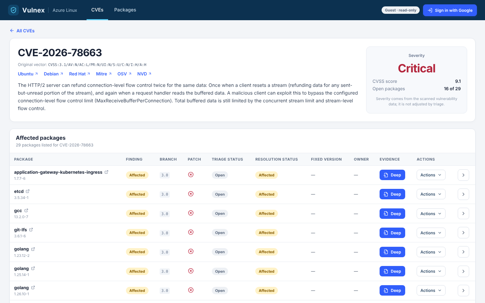

# 3. Frontend

The frontend is a **React 18 + TypeScript** single-page app built with **Vite 6**. It lives in `frontend/`.

## Pages

There are three pages, chosen by the part of the URL after `#`.

| URL | Page | Shows |
|-----|------|-------|
| `#/` | CVEs (`CvesPage.tsx`) | Filter sidebar, four summary cards, findings grouped by CVE |
| `#/packages` | Packages (`PackagesPage.tsx`) | Every scanned package and its version |
| `#/cve/<id>` | CVE detail (`CveDetailPage.tsx`) | The CVE, severity box, tracker links, and a table of every affected package |



Each row on the CVE detail page has a **Deep** button, an **Actions** menu (comment, dispute, GitHub PR, patch verdict) and an arrow to open that package's panel.

## Folder map

```
frontend/src/
  main.tsx, App.tsx        Entry point and the page switch
  app-context.ts           Shares sign-in state and the toast function
  pages/                   The three pages (+ pages.test.tsx)
  components/              TopNav, FilterSidebar, DeepModal, TriageModal, ActionsMenu,
                           FindingPanel, Pagination, StatusPill, Toast, ...
  hooks/                   useHashRoute, useSession, useScan
  lib/                     Pure helpers: route, filters, findings, labels, triage, session
  api/                     client.ts (fetch wrapper) and types.ts (response shapes)
  test/                    Test setup and fixtures
```

## How it talks to the backend

- `api/client.ts` wraps `fetch`, adds the sign-in token as the `X-VULNEX-Key` header, and turns errors into readable messages.
- Requests go to `/api/...` on the same origin. In production Netlify forwards them to Render; in local development the backend serves the built app itself.
- `api/types.ts` describes each response, such as `Finding`, so TypeScript catches a field being renamed.
- Requests are cancelled with an `AbortController` when filters change, so an old slow answer never overwrites a new one.

## Filters

The sidebar filters (CVE id, package, branch, patch, severity, triage status, resolution status, fixed version, owner) are turned into query parameters by `lib/filters.ts`. The backend applies them in SQL, so paging stays correct.

## Sign-in

`useSession` stores the token that the Google sign-in redirect returns (`/#vulnex_token=...`) and asks `/api/role` what the person may do. Buttons such as Actions appear only when the role allows them.

## Tests and build

```bash
cd frontend
npm ci
npm run dev        # development server
npm run typecheck  # TypeScript
npm test           # Vitest + Testing Library
npm run build      # outputs frontend/dist
```

`frontend/app.js` and `frontend/styles.css` are an older build-free dashboard that is still used by the GitHub Pages static export. The React app is the main interface.
